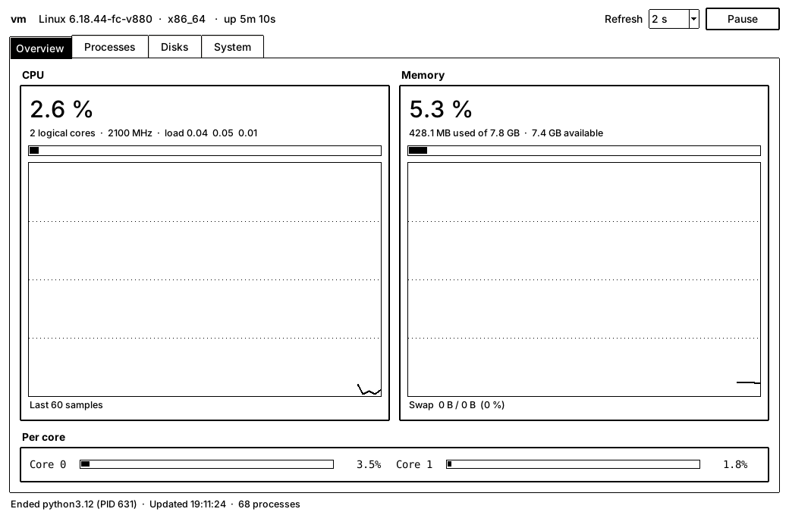
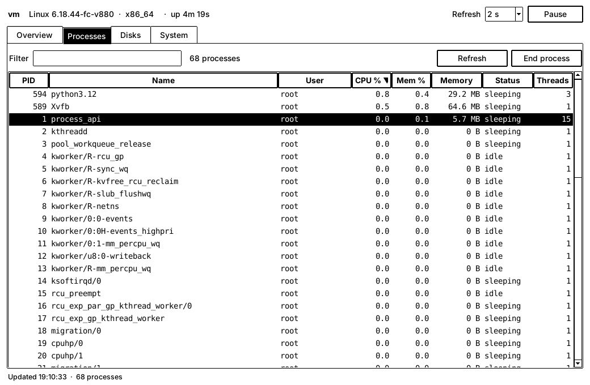

# Process & Resource Monitor

A small desktop tool that shows what a Linux (or Windows) computer is doing right now:
CPU and RAM usage, the running processes, disk space, and basic system information.
Processes can be ended from the list, with safeguards against ending anything critical.

Built with Python, Tkinter and [psutil](https://github.com/giampaolo/psutil).



## Features

- **Live CPU and RAM** – total and per-core CPU, used / available memory, swap, and a 60-sample history graph. Refresh every 1, 2 or 5 seconds, or pause.
- **Process list** – PID, name, user, CPU %, memory %, memory used, status and thread count. Click a column to sort, type in the filter box to search by name, user or PID.
- **Disk usage** – every mounted drive or partition with total, used, free and percent, plus read/write speed.
- **System information** – hostname, OS, CPU model, core count, RAM, boot time and uptime.
- **End process, with safeguards**
  - asks for confirmation and shows the PID, user and memory first
  - refuses core OS processes (PID 0/1/2 on Linux, 0/4 on Windows), kernel threads, and a list of critical names such as `systemd`, `sshd`, `csrss.exe`, `lsass.exe`, `svchost.exe`
  - refuses to end the monitor itself or the terminal that started it
  - checks the process start time before acting, so a PID that was reused by a new process is never hit by mistake
  - asks politely first (SIGTERM); only if the process is still running after 3 seconds does it offer to force it (SIGKILL)
  - clear message when permission is denied (run with `sudo` / as Administrator to manage other users' processes)



## Run it

Requires Python 3.9 or newer.

### Windows

Double-click **`run.bat`**.
The first run sets up a local `.venv` folder and installs psutil (about 10 seconds); after that the window opens straight away.

Or from a terminal:

```
pip install -r requirements.txt
python app.py
```

If `python` isn't found, install it from [python.org](https://www.python.org/downloads/) and tick *Add python.exe to PATH* during setup.

### Linux

```
sudo apt install python3-tk python3-venv     # Debian / Ubuntu
./run.sh
```

Fedora: `sudo dnf install python3-tkinter`. Arch: `sudo pacman -S tk`.

### Text mode (no window, e.g. over SSH)

```
python monitor.py        # or:  ./run.sh --text   /   run.bat --text
```

Prints a one-off report: CPU, RAM, swap, disks and the top 15 processes.

## Tests

```
pip install pytest
python -m pytest tests
```

The tests run automatically on Windows and Ubuntu through GitHub Actions on every push (see the *Actions* tab).

## Project layout

```
monitor.py         data collection and process termination (no GUI)
app.py             the Tkinter window
run.bat / run.sh   one-click launchers
tests/             pytest tests
```

## Notes

- CPU % per process is relative to the whole machine (0–100 %), the same as Windows Task Manager. `top` on Linux shows it per core instead.
- Without admin rights some fields (user, memory) of system processes may be blank; that is the OS restricting access, not an error.
